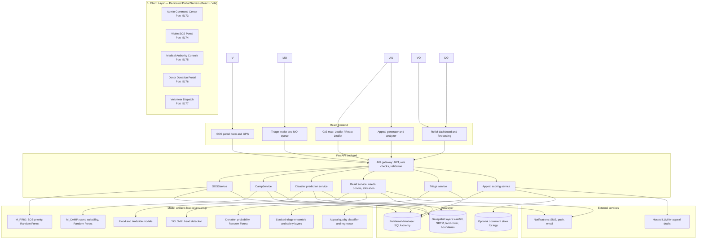
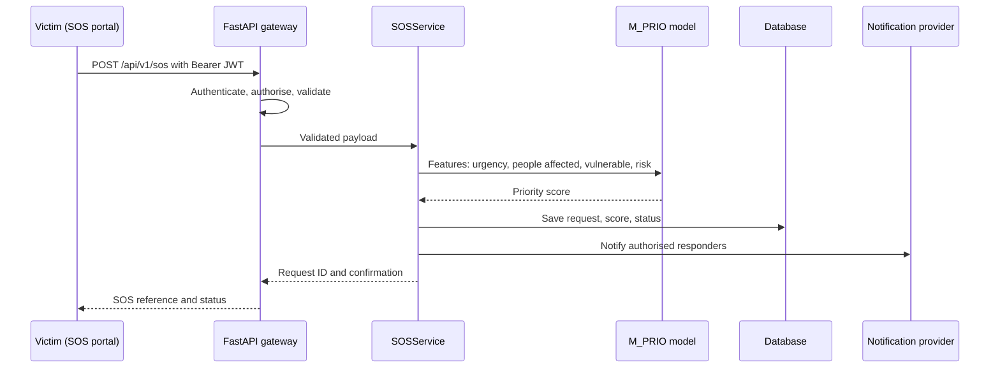
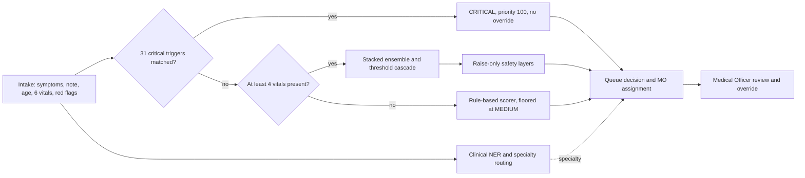

SmartRelief: An Intelligent Disaster Healthcare and Relief Coordination System
Project ID: R26-IT-047
An AI-assisted platform that supports disaster response for floods and landslides in Sri Lanka. It connects emergency reporting, hazard prediction, relief-need forecasting, medical camp planning, patient triage, and donation coordination in one system.
> **Status:** Research prototype. All model outputs are **advisory** and must be reviewed by qualified humans (Medical Officers, authorities, coordinators). The system has not been clinically or behaviourally validated. See [Limitations](#limitations-and-responsible-use).
---
Table of Contents
Overview
Components
System Architecture
1. SOS Alerting System
2. Medical Camp Recommendation Map
3. Disaster Prediction System
4. Integrated Disaster Relief Prediction System
5. Patient Severity Triage
6. Multilingual Donation Appeal Quality Scoring
How the Components Work Together
Tech Stack
Datasets and Licences
Getting Started
Limitations and Responsible Use
Implementation Verification Checklist
Team
---
Overview
After a flood or landslide, responders face incomplete information, limited clinicians, and urgent supply needs. SmartRelief addresses that with:
Emergency reporting with GPS and automatic priority scoring
Hazard risk prediction for floods and landslides
Medical camp site recommendation on an interactive map
Affected-population estimation from images (YOLOv8n head detection)
Relief requirement calculation using government per-person/per-family rates
Next-hour camp population forecasting
Donor targeting using donation-probability scoring and geographic priority
Dynamic donation allocation to avoid over-donation
Patient severity triage decision support for medical camps
Multilingual (English, Sinhala, Tamil) donation appeal quality scoring
Components
Component	Purpose	Main outputs
SOS Alerting System	Manage emergency requests and responder coordination	Saved SOS record, priority score, status, responder alerts
Medical Camp Recommendation Map	Help authorities review suitable temporary medical camp sites	Ranked candidate sites, map overlays
Disaster Prediction System	Estimate flood and landslide risk	Predicted class/score on a risk map
Integrated Disaster Relief Prediction System	Predict relief needs and coordinate donations	Donation requests, dashboard, donor notifications
Patient Severity Triage	Rank patients by severity at medical camps	Severity level, priority score, routing, MO queue
Appeal Quality Scoring	Rate donation appeal text	LOW / MEDIUM / HIGH label, 1-5 score, confidence
> **Quick distinction:** Disaster prediction estimates geographic hazard risk; SOS alerting manages emergencies people report; camp recommendation combines risk and demand to support medical planning. These are connected logical components, not one model doing everything.
System Architecture
All components run as REST services (FastAPI) behind a React front end, sharing data through the backend and a relational database (SQLAlchemy), with an optional document store for logs.
Overall architecture


---

## Key Architectural Tenets

**1. Role-Based Access Control by Construction**
Authentication and authorization are fully decoupled from domain business logic. Every protected endpoint enforces permissions via stateless JWT claims evaluated by the declarative `Depends(require_role([...]))` guard. Fail-closed semantics guarantee that missing or malformed tokens default to immediate HTTP 401/403 rejection.

**2. Five Isolated Stakeholder Portals**
The React frontend runs as multiple Vite development servers, each bound to a dedicated TCP port and initializing with the UI context for its assigned stakeholder role. Portal detection is automatic through environment, port, path, and query-parameter configuration. A single `npm run dev:all` command starts all configured servers concurrently.

**3. Explainable Multi-Model AI Pipeline**
Four task-specific Random Forest models operate sequentially:
- **Landslide Model** — 3-tier severity classification from 257 verified Sri Lankan incidents (F₁ = 0.9476)
- **Flood Model** — river basin risk from hydrology, land-use, and infrastructure exposure (F₁ = 0.8694)
- **Camp Model** — optimal medical camp placement regressor (R² = 0.9072)
- **Priority Model** — time-decayed triage urgency scorer (R² = 0.8241)

**4. Stateless Scalability**
No session table lookups on protected routes. JWT tokens embed `user_id` and `role` claims directly, enabling high-throughput, horizontally scalable API operation without distributed session state.

**5. Relational Integrity**
Eight normalized entities enforce strict referential integrity with support for partial donor pledges and multi-victim geographic clusters.

---

## Technology Stack Summary

| Layer | Component | Technology | Rationale |
| :--- | :--- | :--- | :--- |
| **Frontend** | React SPA | React 19 + Vite 8 | Fast HMR, tree-shaking, ES modules |
| **UI Icons** | Icon system | Lucide React | Professional SVG vector icons; zero emoji dependency |
| **Mapping** | GIS layer | Leaflet + React-Leaflet | Lightweight, tile-agnostic, offline-capable |
| **Charts** | Analytics | Chart.js + react-chartjs-2 | Declarative charting with rich animation |
| **API Framework** | REST Backend | FastAPI (Python 3.10+) | Async, native OpenAPI, clean DI for RBAC |
| **Data Persistence** | ORM + DB | SQLAlchemy 2.0 + MySQL 8.0 (Docker) / SQLite (Local) | Strict FK constraints; auto-detecting connection pool engine |
| **Security & Auth** | JWT + Crypto | PyJWT + passlib (bcrypt) | Adaptive bcrypt hashing, stateless claims tokens |
| **Machine Learning** | Training & Inference | scikit-learn + joblib + pandas | Zero-inference overhead; RF suited to tabular disaster data |
| **Testing** | Automated QA | pytest + httpx + TestClient | In-memory SQLite isolation; 27/27 tests passing |

---

## Quick Execution Guide

### Prerequisites

```powershell
# Python 3.10+ and Node.js 18+ are required.
# Verify installed versions:
python --version
node --version
npm --version
```
SOS request flow

Patient triage pipeline

> These diagrams use [Mermaid](https://mermaid.js.org/), which GitHub renders automatically in `README.md`. The overall diagram shows the intended design from the architecture notes. Verify each box against the actual code using the [checklist](#implementation-verification-checklist) before presenting it as implemented.
Model binaries (e.g., `.joblib`) are loaded into memory at application startup so models are not retrained or reloaded per request.
---
1. SOS Alerting System
Lets a disaster-affected person request help. It captures the emergency and location, validates the request, calculates a priority score, stores the record, and notifies responders.
Flow: Victim SOS portal (form + GPS) -> FastAPI gateway (JWT, role checks, validation) -> `SOSService` (severity and priority scoring) -> relational database -> notifications to authorised responders.
Frontend
Emergency form (type, description, number affected, vulnerability/urgency indicators, contact details)
GPS capture with manual location fallback
Confirmation with SOS reference and live status (e.g., Active, Acknowledged, Assigned, Responding, Resolved)
Backend request lifecycle
Receive: `POST /api/v1/sos` with payload and Bearer JWT
Authenticate: verify token signature, expiry, algorithm (401 on missing/invalid token)
Authorise: role check (403 for authenticated but unauthorised roles)
Validate: required fields, coordinate ranges, allowed categories
Assess: run the priority model
Persist: store request, priority, and status via SQLAlchemy
Notify: alert delivery after a successful save
Respond: return request ID and confirmation
Priority model (`M_PRIO`): Random Forest regressor. Candidate features: urgency, number of affected people, vulnerable people, and risk. The score is a ranking value, not a probability or medical outcome, and a documented triage policy interprets it.
Notifications may use SMS, push, email, or an in-app dashboard; failures, retries, and duplicates must not lose the saved SOS record.
2. Medical Camp Recommendation Map
A decision-support tool that helps authorities identify and review candidate temporary medical camp sites. Authorities make the final decision.
Inputs: flood/landslide risk, SOS demand, terrain, roads, boundaries, population, medical facilities, existing camps.
Map layers (Leaflet / React-Leaflet)
Flood and landslide risk overlays
SOS markers (sensitive victim details protected)
Suggested vs. existing/approved camps
Roads and nearby hospitals/clinics
`CampService` responsibilities: collect spatial inputs, estimate demand, generate candidates, evaluate constraints, rank candidates, return results to the map, and record decisions (if implemented).
Suitability model (`M_CAMP`): Random Forest regressor over criteria such as affected population, SOS demand, hazard risk, distance to affected communities, road accessibility, existing facilities, and site safety/capacity.
> **Safety rule:** A high suitability score must never override a hard safety constraint. Ranking does not prove a site is safe; reliable hazard data and human review are required.
3. Disaster Prediction System
Estimates flood and landslide risk for supported areas from historical disaster records and environmental/geospatial features. A prediction is not a guarantee that a disaster will occur.
Data and variables (confirm which are used in each trained model)
Data	Role
Historical flood / landslide records	Labels for modelling
Rainfall (e.g., CHIRPS)	Precipitation conditions
SRTM elevation and derived slope	Terrain; slope is key for landslides
ESA land cover	Land-cover characteristics
SMAP soil moisture	Environmental information, if included
GN or other boundaries	Link predictions to mapped areas
Training vs. inference: training is offline (collect, engineer features, train/compare, evaluate, save model + preprocessing). Inference loads the saved artifacts, validates inputs in the same format, predicts, and renders results on the map or passes them to camp planning.
Reported research results (prior project notes, not independently re-evaluated)
Hazard	Reported model / result
Flood	Logistic Regression selected, 82.4% reported (Random Forest also noted at 0.882)
Landslide	Random Forest, 91.3% reported
The architecture diagram labels both models as Random Forest classifiers, which should be reconciled with the deployed artifacts. Metric names (accuracy vs. other) and test splits should be confirmed before comparing figures.
Live prediction requires an identified data source, ingestion process, update schedule, stale-data handling, and features matching the training schema. A historical model is not automatically a live or forecasting system.
4. Integrated Disaster Relief Prediction System
An AI-driven component for disaster healthcare forecasting and emergency donation coordination, currently scoped to floods and landslides in Sri Lanka. It replaces manual estimation of relief needs with an automated pipeline.
4.1 Affected population estimation (YOLO)
Affected people are counted from images captured at designated safety centres by detecting visible human heads. For large centres, multiple zone images are processed and counts are combined.
Dataset: Head Detection, Version 1 (Roboflow Universe, Crowd workspace)
Setup: YOLOv8n, YOLO11n, and YOLO26n trained from scratch under identical conditions (max 150 epochs, patience-based early stopping)
Validation set: 422 images, 4,449 head instances
Model	Precision	Recall	mAP50	mAP50-95	Epochs	Time (h)
YOLOv8n (deployed)	0.914	0.798	0.886	0.569	126	0.29
YOLO11n	0.911	0.782	0.878	0.566	150	0.39
YOLO26n	0.888	0.776	0.870	0.554	148	0.50
4.2 Essential relief requirement prediction
The estimated population is combined with official government per-person and per-family requirement rates to calculate quantities of drinking water, food packs, over-the-counter (OTC) medicines, hygiene products, and other non-food essentials. These become structured donation requests automatically.
4.3 Disaster prediction dashboard
Shows estimated affected population per safety centre, active requests, predicted item quantities, severity, and model insights for hospitals, divisional secretariats, NGOs, relief coordinators, volunteers, and registered donors.
4.4 Next-hour population forecasting
Camp occupancy is modelled as a time-series regression problem using hourly camp population, rainfall intensity, and river/flood water level.
Features: lagged population (1, 3, 6 hours), short-term changes, rolling averages, cumulative recent rainfall
Model: Random Forest Regression
Deployment: exported to a lightweight JSON representation of the decision trees and executed in the browser with JavaScript, so it works where server connectivity is unreliable
4.5 AI-based donation probability scoring
A Random Forest regression model predicts which donors are most likely to contribute, using donation frequency, item categories, quantities, response time, and distance to the disaster. Only high-probability donors are prioritised for email notifications.
4.6 Geographic donor prioritisation
Nearby donors get higher priority. The final recommendation combines the donation probability score with geographic accessibility.
4.7 Dynamic donation allocation
Continuously tracks donated quantities, remaining needs, and urgency. Requests for fulfilled items stop, while items with shortages continue to receive priority.
5. Patient Severity Triage
Decision support for disaster medical camps. The output is advisory, and a Medical Officer (MO) makes every decision.
Workflow
Intake: MO enters symptoms, clinical note, age, six vitals (heart rate, SpO2, systolic BP, respiratory rate, temperature, pain), and red-flag checkboxes. Values outside physiological ranges are rejected.
Clinical NER and routing: scispaCy `en_core_sci_sm` extracts entities (with a keyword fallback), matched against 17 specialties (10 condition groups). An age rule adds Pediatric (under 12) and Geriatric (65 and over). Entity extraction is used for routing only.
Critical rule check: 31 critical triggers (e.g., cardiac arrest, anaphylaxis, stroke, crush injury). A match sets CRITICAL (priority 100), bypasses ML, and disables override.
Severity engine:
If at least 4 vitals are present: stacked ML ensemble (after a complaint mapper rewrites typed text into coded complaints)
Otherwise: rule-based classifier with weighted keywords
With fewer than 4 vitals or low complaint coverage (< 0.5), the result is floored at MEDIUM and flagged for review, so these patients are never auto-assigned LOW
Queue decision: HIGH and CRITICAL auto-queue; MEDIUM if risk score >= 40; LOW only as an audit sample when a rule matched
MO assignment: highest score of role weight (senior MO 1.0, MO 0.85, resident 0.65, intern 0.45) x specialty factor (1.0 match, 0.5 otherwise) x 1/(1 + queue depth). Interns/residents without a supervisor are excluded for HIGH patients.
Clinician review: MO can change severity with a recorded reason (not possible for CRITICAL)
Model
Base models (class-balanced): 3 logistic regressions (C = 0.3, 0.1, 0.05), LightGBM (400 trees), XGBoost (400 trees, depth 5)
Meta-learner: class-balanced logistic regression on 5-fold profile-grouped out-of-fold probabilities
Features: 1,457 linear / 193 tree features (age, vitals with missing indicators, threshold flags, red flags, TF-IDF of complaint text)
Threshold cascade: `T_HIGH = 0.39`, `T_LOW = 0.40`, tuned for HIGH recall >= 0.90
Safety layers (raise-only): Layer 1 floors to HIGH on any red flag; Layer 2 floors to HIGH on 16 high-acuity complaint patterns
Results (NHAMCS 2022, 7,578 ED visits, profile-disjoint splits)
Split: 6,090 train / 748 validation / 740 test. Labels come from a clinician-guided policy, so the task is policy reproduction.
Partition	n	Acc.	Bal. acc.	Macro F1	HIGH recall	HIGH->LOW
Train, fitted	6,090	0.949	0.947	0.944	0.959	14
Train, OOF	6,090	0.919	0.916	0.913	0.932	36
Validation	748	0.910	0.905	0.899	0.900	2
Test	740	0.888	0.885	0.883	0.905	5
Safety-layer ablation (test set)
Setting	Bal. acc.	HIGH recall	HIGH->LOW	MED->HIGH
Model only	0.914	0.872	8	22
Red-flag layer only	0.885	0.882	8	39
Complaint layer only	0.915	0.896	5	24
Both layers (deployed)	0.885	0.905	5	41
Key findings
5 of 211 HIGH patients (2.4%) are assigned LOW; the policy deliberately over-triages (41 of 241 MEDIUM patients promoted to HIGH)
The complaint layer is the efficient safeguard; the red-flag layer drives most over-triage
Robustness: HIGH recall falls from 0.905 to 0.836 when 50% of vitals are missing; typed free text without the complaint mapper drops balanced accuracy to 0.802 (mapper restores baseline)
HIGH recall is lowest for patients aged 65 or over (0.765)
6. Multilingual Donation Appeal Quality Scoring
Rates English, Sinhala, and Tamil donation appeals as LOW / MEDIUM / HIGH with a 1-5 score, using no pretrained embeddings.
Workflow
Generator: a hosted LLM drafts variants from language, campaign type, location, verified need, goal, tone, channel, and length. Falls back to fixed templates if no provider is available.
Analyzer: scores pasted text (10 to 10,000 characters), lists heuristic issues, and can request a rewrite that is re-scored.
The user supplies the language label (the UI warns on script mismatch). Confidence below 0.5 triggers a manual-review warning. A handcrafted rule scorer replaces the model if its files fail to load.
The scorer reads only appeal text and language, so the "verified need" is not checked against any camp or inventory record.
Pipeline
English: word 1-2-gram TF-IDF (25,000 features) + 150-dim LSA
Sinhala / Tamil: character 3-5-gram TF-IDF (8,000 features) + 50-dim LSA
Plus: 13 scaled handcrafted features (length, digit/capital ratios, punctuation, currency and donation-word flags, language flags)
Classifier: calibrated Random Forest (500 trees, depth 20, balanced weights, 5-fold isotonic calibration)
Regressor: Gradient Boosting (300 trees) with isotonic correction, clipped to 1-5
Corpus
Final training corpus: 5,627 appeals (4,600 English, 511 Sinhala, 516 Tamil). Sinhala and Tamil data are mostly augmented or AI-generated (only 20 Sinhala and 28 Tamil web-sourced native appeals). The corpus is research-only and not redistributed.
Results (held-out test set, n = 1,126)
Subset	n	Accuracy	95% CI (Wilson)	MAE
English	901	0.782	0.754-0.808	0.354
Sinhala	111	0.883	0.810-0.930	0.253
Tamil	114	0.895	0.825-0.939	0.249
All	1,126	0.804	0.780-0.826	0.333
5-fold cross-validation accuracy: 0.784 +/- 0.008. Regressor R2: 0.755. Errors concentrate at the MEDIUM/HIGH boundary.
> Sinhala and Tamil figures reflect how consistently augmented text follows the labelling scheme and **should not be read as real-world quality prediction**.
---
How the Components Work Together
Example: flood risk is elevated in an area of Kaduwela and several people submit SOS requests nearby.
Disaster prediction supplies the flood-risk estimate for the area
SOS alerting validates requests, scores priority, stores them, and notifies responders
Spatial analysis combines risk, SOS density, roads, population, and medical facilities
Camp recommendation ranks candidate sites subject to safety constraints
Authority review decides where to deploy resources
Relief prediction estimates affected population at safety centres, generates donation requests, and targets donors
Triage at the camps ranks patients for Medical Officers, while appeal scoring helps coordinators improve donation appeals
Tech Stack
Area	Technologies
Backend	Python, FastAPI, SQLAlchemy, JWT authentication
Frontend	React, Leaflet / React-Leaflet
Database	Relational database (optional document store for logs)
ML / NLP	scikit-learn (Random Forest, Logistic Regression, Gradient Boosting), LightGBM, XGBoost, scispaCy, TF-IDF, LSA
Computer vision	YOLOv8n (Ultralytics-style head detection)
Deployment	`.joblib` model artifacts loaded at startup; browser-side JSON tree inference for population forecasting
Testing	pytest (covers all 31 critical triggers, vitals floors, complaint mapping, entity filtering, age-aware routing)
Datasets and Licences
Dataset	Used for	Notes
Roboflow Head Detection v1	YOLO head detection	Roboflow Universe, Crowd workspace
NHAMCS 2022 ED public-use file (NCHS/CDC)	Triage model	US ED data
MDCC (subset)	English appeal corpus	CC BY-NC 4.0 (attribution, non-commercial)
GoFundMe public research corpus	English appeal corpus	Public research corpus
CHIRPS, SRTM, ESA land cover, SMAP	Hazard features	Use depends on the trained model
Getting Started
> Fill in the commands below to match your repository.
```bash
# Clone the repository
git clone <your-repo-url>
cd <your-repo-folder>

# Backend
cd backend
python -m venv venv
source venv/bin/activate        # Windows: venv\Scripts\activate
pip install -r requirements.txt
uvicorn main:app --reload

# Frontend
cd ../frontend
npm install
npm start
```

### Step 7 — Launch the stakeholder portals (Terminal 2)

**Launch all configured portals simultaneously:**
```powershell
cd "D:\My research\SDM Project refine\frontend"
npm run dev:all
```

> `npm run dev:all` executes `start_portals.js`, which spawns five independent Vite processes with color-coded terminal output and coordinated `SIGINT` shutdown.

**Or launch an individual portal:**
```powershell
npm run dev:admin      # Admin Command Center    → http://localhost:5173
npm run dev:victim     # Victim SOS Portal       → http://localhost:5174
npm run dev:authority  # Medical Authority        → http://localhost:5175
npm run dev:donor      # Donor Donation Portal    → http://localhost:5176
npm run dev:volunteer  # Volunteer Dispatch       → http://localhost:5177
```

---

## Portal Access Matrix

| Portal | URL | Default Login | Role |
| :--- | :--- | :--- | :--- |
| Admin Command Center | http://localhost:5173 | admin@disaster.relief.lk | admin |
| Victim SOS Portal | http://localhost:5174 | victim@kaduwela.lk | victim |
| Medical Authority Console | http://localhost:5175 | authority@moh.gov.lk | authority |
| Donor Donation Portal | http://localhost:5176 | donor@redcross.lk | donor |
| Field Volunteer Dispatch | http://localhost:5177 | volunteer@relief.lk | volunteer |

> Default passwords follow the pattern `<Role>@2026!` (e.g., `Admin@2026!`). These credentials are seeded during database initialization and are intended for development and demonstration environments only.
Configuration (example, adjust to your project):
```env
DATABASE_URL=
JWT_SECRET=
JWT_ALGORITHM=
# Notification provider keys, LLM provider keys, etc.
```
> Trained model artifacts and the appeal corpus are not included in the repository. Place model files in the expected directory (e.g., `models/`) before starting the backend.
Limitations and Responsible Use
Advisory only. Triage, camp ranking, priority scores, and appeal scores support human decisions; they do not replace them.
Triage: trained on US ED data (NHAMCS), which differs from disaster-camp populations. Labels come from a single reviewed policy without inter-rater agreement or outcome data, and no probability-calibration analysis is reported. A physician's informal review judged that the component addresses the problem and asked for more specialties. Independent outcome labels, calibration checks, and an ethics-approved pilot are needed before field use.
Rule paths (critical triggers, floors) are unit-tested to behave as written, not scored for clinical correctness.
Appeal scoring: the Sinhala/Tamil data is largely augmented; the random test split may allow near-duplicates on both sides; scores should advise coordinators, not decide whether a request is genuine. Part of the English text comes from real individuals' campaigns, so text must be paraphrased or anonymised before display.
Hazard prediction: a historical model is not a live forecasting system, and reported metrics should not be compared across different metric definitions.
Camp recommendation: model ranking does not prove a physical location is safe.
Before field use, the platform also needs access control, rate limiting, consent, and a data retention policy.
Implementation Verification Checklist
Use this checklist to compare the design notes against the repository; a design alone does not prove a feature is implemented.
Area	Check in source code
SOS API	Router, endpoint path, schemas, HTTP status codes
Authentication	JWT signature/expiry/algorithm checks, role and ownership rules
SOS priority	Loaded model, feature order, preprocessing, output range, thresholds
Database	SQLAlchemy models, status values, foreign keys, transactions
Notifications	Actual provider, recipient selection, retries, delivery status
Camp recommendations	`CampService`, candidate generation, suitability function, safety constraints, approval workflow
GIS map	Risk overlays, SOS and candidate markers, API calls, access control for sensitive data
Flood prediction	Whether the deployed artifact is Logistic Regression or Random Forest; evaluation metric
Landslide prediction	Model artifact, training features, geographic resolution, metric
Live data	Source, refresh schedule, staleness and missing-data handling
Model startup	Application lifespan, artifact versions, preprocessing compatibility
Team
Name	Student ID
E. M. K. N. Ekanayake	IT22104076
D. K. S. D. Perera	IT22128522
Fernando R. U.	IT22177414
<!-- Add supervisors and institution here if you want them listed -->
Licence
<!-- Add your licence. Note: the MDCC-derived data is CC BY-NC 4.0 (non-commercial), and the appeal corpus is research-only. -->
